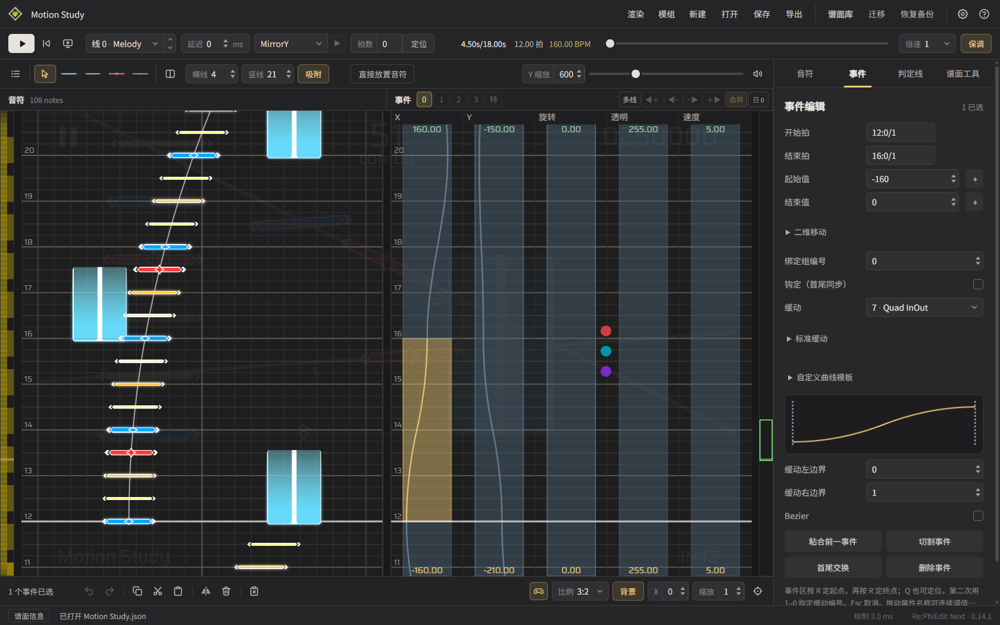
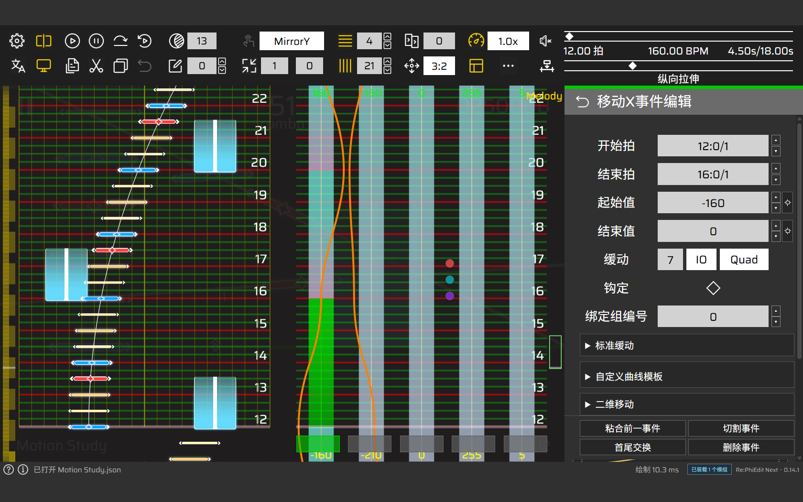

<p align="center">
  
</p>

<h1 align="center">Re:PhiEdit Next</h1>

<p align="center">An unofficial Phigros chart editor, from note placement to animation design</p>

<p align="center">
  <a href="https://kclg-ysj.github.io/rpe-next/">Try online</a> ·
  <a href="https://github.com/kclg-YSJ/rpe-next/releases">Desktop downloads</a> ·
  <a href="GUIDE.zh-CN.md">User guide (中文)</a> ·
  <a href="https://github.com/kclg-YSJ/rpe-next/issues">Report an issue</a>
</p>

<p align="center"><a href="README.md">简体中文</a> · <strong>English</strong></p>

Re:PhiEdit Next is a reconstruction of **Re:PhiEdit (RPE)** by **cmdysj**, developed with **AI (GPT)**. The web and desktop editions share an editing interface for notes, judge line animations, audio analysis, and video rendering.

Current source version: **0.14.1**. See [releases](https://github.com/kclg-YSJ/rpe-next/releases) for published versions and changes.

## Features

| Area | Highlights |
| --- | --- |
| Notes and events | Single-line and multi-line editing, batch operations, guide curve snapping, XY binding, undo and redo |
| Animation and motion | Standard easing, custom animation curves, judge line paths, note distance curves, event value scaling |
| Preview and rendering | Live preview, spatial trajectories, custom shaders, chart video export, full-editor playback rendering |
| Audio analysis | Waveforms and spectra, stem separation, predominant pitch, onset detection, rhythm drafts |
| Chart management | JSON / PEC / PEZ import, local chart library, automatic backups, chart version control |
| Extensions and collaboration | Editor skins, note resource packs, mods, global events, collaborative editing |
| AI assistance | Query and edit charts in natural language, run charting tools, analyze audio, and manage assets |

The desktop edition also offers large-chart viewing and editing, plus local audio analysis environments. See the [user and development guide](GUIDE.zh-CN.md) for workflows and supported scope.

## Screenshots

**Inkline · Notes, guide curves, and event curves**



**RPE Classic · Classic layout and event editing**



## Download and get started

- **Web**: [Open the editor](https://kclg-ysj.github.io/rpe-next/). Desktop Edge or Chrome with hardware acceleration is recommended.
- **Desktop**: Download the package for your system and architecture from [Releases](https://github.com/kclg-YSJ/rpe-next/releases). The runtime is included.

| System | Package | Launch |
| --- | --- | --- |
| Windows · x64 / ARM64 | ZIP | Extract and run `RePhiEdit-Next.exe` |
| macOS · Apple silicon | DMG | Drag the app into Applications, then open it |
| Linux · x64 / ARM64 | tar.xz | Extract and run `RePhiEdit-Next` |

1. Create a chart in the library, or use **Open JSON / PEZ** to import a chart and its assets.
2. Use **Q / W / E / R** to place Tap / Drag / Flick / Hold notes and **Space** to play or pause. Shortcuts are configurable in Settings.
3. Save to the local chart library. Export as **PEZ** to include music, artwork, and other referenced assets.

## Documentation

Detailed guides and technical references are currently written in Chinese.

| Document | Contents |
| --- | --- |
| [User and development guide](GUIDE.zh-CN.md) | Editing, settings, storage, privacy, and development details |
| [Stem separation guide](protocols/AUDIO-SEPARATION.zh-CN.md) | Environment setup, stem playback, and audio analysis |
| [Video rendering](protocols/VIDEO-RENDER.zh-CN.md) | Video output, settings, and rendering interfaces |
| [Mod protocol](protocols/MOD-PROTOCOL.zh-CN.md) | Mod development, permissions, and extension APIs |
| [Editor skin protocol](protocols/EDITOR-SKIN-PROTOCOL.zh-CN.md) | UI styling, layout, and canvas palettes |
| [AI Agent protocol](protocols/AI-AGENT-PROTOCOL.zh-CN.md) | AI tools, editing permissions, and commands |
| [Collaboration server](collaboration-server/README.md) | Server deployment and collaborative rooms |

Feature details and future additions belong in these guides and topic documents.

## Run locally and develop

Install **Node.js 22+**, then run in the project directory:

```sh
npm start
```

Open `http://127.0.0.1:4173` in your browser. On Windows, you can also double-click `start.cmd`.

For development and validation:

```sh
npm ci
npm test
npm run build:pages
```

See [development and validation](GUIDE.zh-CN.md#开发与验证) for more build steps. Contributions are welcome through [Issues](https://github.com/kclg-YSJ/rpe-next/issues) and [Pull Requests](https://github.com/kclg-YSJ/rpe-next/pulls). Please include the version, environment, and steps to reproduce when reporting a problem.

## Credits

- **Re:PhiEdit (RPE)**: original code and assets.
- **Stellate**: noise-field skin protocol and the built-in NoiseField and Ocean skins.
- **-虹之梦-**: the Sea of Dreams - Neo note skin.
- **NyamonZone**: the Nyamon mod marketplace.
- **@柠喵酱**: the video rendering module.
- **RPE Classic maintainers**: the classic editor skin and companion layout.

See [NOTICE](NOTICE) for the full attribution and third-party notices.

## License

Licensed under [PolyForm Noncommercial 1.0.0](LICENSE) for noncommercial uses permitted by its terms. Contact the author for commercial licensing. Redistributions must retain the license and required notices; third-party content follows its own licenses.
