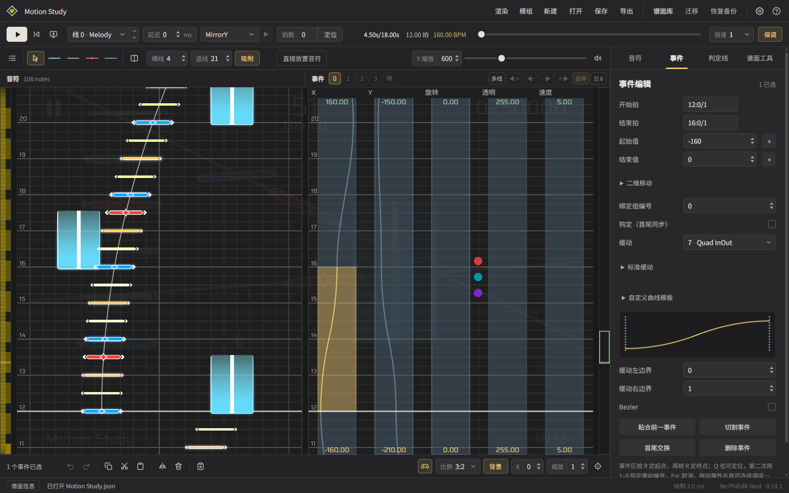
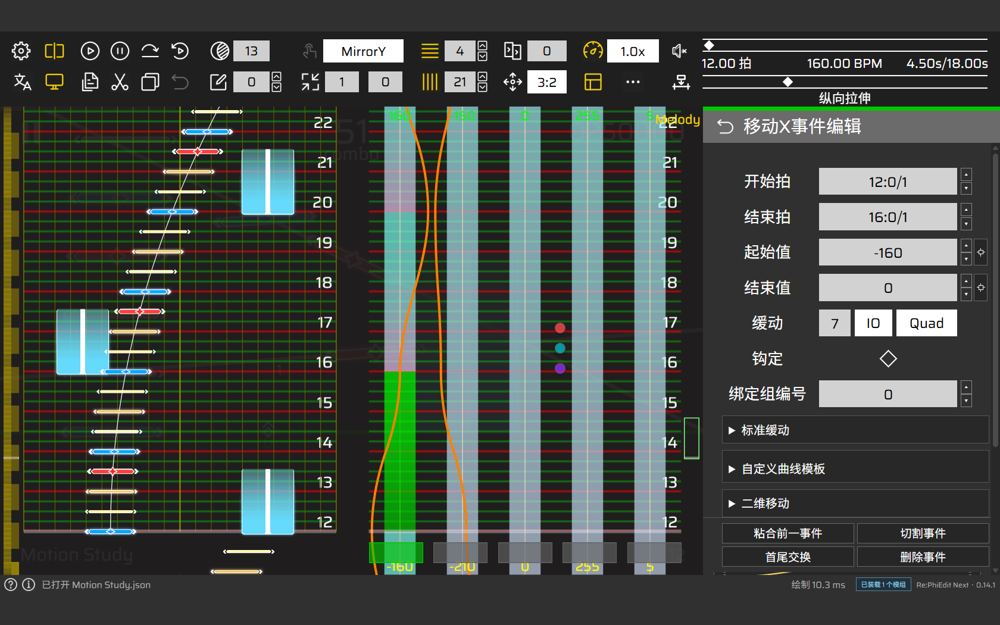

<p align="center">
  
</p>

<h1 align="center">Re:PhiEdit Next</h1>

<p align="center">从音符编排到动画设计的 Phigros 非官方制谱器</p>

<p align="center">
  <a href="https://kclg-ysj.github.io/rpe-next/">在线使用</a> ·
  <a href="https://github.com/kclg-YSJ/rpe-next/releases">桌面下载</a> ·
  <a href="GUIDE.zh-CN.md">使用指南</a> ·
  <a href="https://github.com/kclg-YSJ/rpe-next/issues">问题反馈</a>
</p>

<p align="center"><strong>简体中文</strong> · <a href="README.en.md">English</a></p>

Re:PhiEdit Next 由 **cmdysj** 基于原 **Re:PhiEdit（RPE）**，使用 **AI（GPT）** 重构。网页和桌面共用编辑界面，支持音符、判定线动画、音频分析与视频渲染。

当前代码版本：**0.14.1**。更新内容见 [发布记录](https://github.com/kclg-YSJ/rpe-next/releases)。

## 功能概览

| 方向 | 主要功能 |
| --- | --- |
| 音符与事件 | 单线／多线编辑、批量操作、引导线吸附、XY 绑定、撤销与重做 |
| 动画与轨迹 | 标准缓动、自定义动画曲线、判定线轨迹、调速曲线、事件数值缩放 |
| 预览与渲染 | 实时预览、空间轨迹、自定义 Shader、谱面视频输出、编辑器播放渲染 |
| 音频分析 | 波形与频谱、声部分离、显著音高、起音检测、节奏草稿 |
| 谱面管理 | JSON／PEC／PEZ 导入、本地谱面库、自动备份、谱面版本控制 |
| 扩展与协作 | 编辑器皮肤、音符资源包、模组、全局事件、联机协作 |
| AI 辅助 | 自然语言查询与编辑，调用制谱工具、分析音频和管理素材 |

桌面版还提供超大谱面查看与编辑，以及本机音频分析环境。具体操作与适用范围见 [使用与开发参考](GUIDE.zh-CN.md)。

## 界面预览

**墨线 · 音符、引导线与事件曲线**



**RPE Classic · 经典布局与事件编辑**



## 下载与开始

- **网页版**：[直接打开](https://kclg-ysj.github.io/rpe-next/)，推荐桌面版 Edge 或 Chrome，并开启硬件加速。
- **桌面版**：从 [发布页](https://github.com/kclg-YSJ/rpe-next/releases) 下载对应系统与架构的安装包，运行环境随包提供。

| 系统 | 包格式 | 启动方式 |
| --- | --- | --- |
| Windows · x64 / ARM64 | ZIP | 解压后运行 `RePhiEdit-Next.exe` |
| macOS · Apple 芯片 | DMG | 将应用拖入 Applications 后打开 |
| Linux · x64 / ARM64 | tar.xz | 解压后运行 `RePhiEdit-Next` |

1. 在谱面库中新建谱面，或通过“打开 JSON / PEZ”导入谱面与素材。
2. 默认使用 **Q / W / E / R** 放置 Tap / Drag / Flick / Hold，**空格**播放或暂停；热键可在设置中调整。
3. 保存到本地谱面库，使用 **PEZ** 导出并携带音乐、曲绘等资源。

## 文档

| 文档 | 内容 |
| --- | --- |
| [使用与开发参考](GUIDE.zh-CN.md) | 编辑操作、设置、数据存储、隐私与开发细节 |
| [声部分离使用指南](protocols/AUDIO-SEPARATION.zh-CN.md) | 环境准备、声部试听与音频分析 |
| [视频渲染说明](protocols/VIDEO-RENDER.zh-CN.md) | 视频输出、参数与渲染接口 |
| [模组协议](protocols/MOD-PROTOCOL.zh-CN.md) | 模组开发、权限与扩展接口 |
| [编辑器皮肤协议](protocols/EDITOR-SKIN-PROTOCOL.zh-CN.md) | 界面样式、布局与画布色板 |
| [AI Agent 协议](protocols/AI-AGENT-PROTOCOL.zh-CN.md) | AI 工具、编辑权限与命令层 |
| [协作服务器说明](collaboration-server/README.md) | 部署服务器与创建联机房间 |

功能细节与后续新增说明统一维护在使用指南及专题文档中。

## 本地运行与开发

安装 **Node.js 22+**，在项目目录运行：

```sh
npm start
```

浏览器访问 `http://127.0.0.1:4173`。Windows 也可双击 `start.cmd`。

开发与验证：

```sh
npm ci
npm test
npm run build:pages
```

更多构建步骤见 [开发与验证](GUIDE.zh-CN.md#开发与验证)。欢迎通过 [Issues](https://github.com/kclg-YSJ/rpe-next/issues) 反馈问题，或通过 [Pull Requests](https://github.com/kclg-YSJ/rpe-next/pulls) 参与改进；反馈时请附版本、运行环境和复现步骤。

## 致谢

- 原 **Re:PhiEdit（RPE）** 项目：代码与素材基础。
- **Stellate**：噪域皮肤协议及 NoiseField、Ocean 内置皮肤。
- **-虹之梦-**：梦之海（Sea of Dreams - Neo）音符皮肤。
- **NyamonZone**：Nyamon 模组市场。
- **@柠喵酱**：视频渲染模块。
- **RPE Classic 维护方**：经典编辑器皮肤与配套布局。

完整来源与第三方声明见 [NOTICE](NOTICE)。

## 许可

采用 [PolyForm Noncommercial 1.0.0](LICENSE)，许可符合条款的非商业用途。商业授权请联系作者，再分发时请保留许可证与必需声明；第三方内容遵循各自许可。
