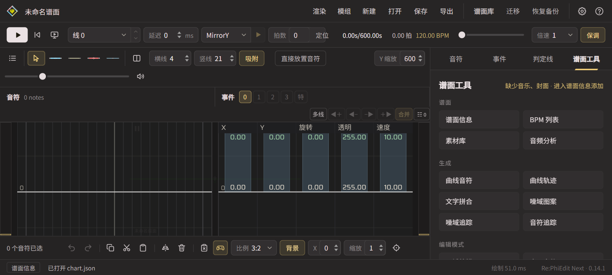

# Re:PhiEdit Next · Android（APK）

把 [Re:PhiEdit Next](https://github.com/kclg-YSJ/rpe-next) 的网页版装进 Android 应用。
编辑器本身一行没重写 —— 这个目录只是用 [Capacitor 7](https://capacitorjs.com) 套了一层 WebView 壳，
再补上手机端真正缺的几件事。

> 这是非官方移植，基于上游 **v0.14.1**。上游项目的许可为
> [PolyForm Noncommercial 1.0.0](../LICENSE)，本目录同样适用，不得商用；
> 分发时请保留 [LICENSE](../LICENSE) 与 [NOTICE](../NOTICE)。



## 为什么可以这么做

上游 `npm run build:pages` 产出的就是一个完整静态站（没有打包器，`src/` 直接用 ES module 加载），
所以只要一个能加载本地静态资源的 WebView 就能跑。壳里额外补的：

| 能力 | 做法 |
| --- | --- |
| 导出谱面 / 视频落地 | 网页用 `<a download href="blob:…">` 导出，WebView 存不了 blob。由 `app-shell/native-bridge.js` 拦截，分块交给 `MainActivity` 写入 `下载/RePhiEditNext/` |
| 桌面宽度排版 | 编辑器是为 1280px 宽设计的；手机横屏只有 ~360px 高，按窄屏重排会把时间轴压成 0 高。改成声明 1280 宽并整体缩放 |
| 强制横屏 | `screenOrientation="sensorLandscape"` |
| 返回键 | 先关弹窗 → 回谱面库 → 才退出 |
| 手指拖动时间轴 | 上游只支持滚轮，见下方“对上游的改动” |

## 安装

从 [Releases](../../releases) 下载 `RePhiEdit-Next-<版本>.apk` 安装。要求 **Android 8.0+**，
并且系统 WebView 已更新（编辑器需要较新的 Chromium：ES module、OPFS、WebCodecs）。

## 构建

需要：

- **Node.js 22+**
- **JDK 21**（AGP 8.7 不支持 22+；`JAVA_HOME` 必须指向 21）
- **Android SDK**：platform 35 + build-tools 35.0.0，通过 `ANDROID_HOME` 指定

```bash
cd android-shell
npm install

# 一条命令走完：构建静态站 → 生成 www → cap sync → gradle
powershell -ExecutionPolicy Bypass -File tools/build-apk.ps1        # Windows
```

只想要调试包：加 `-DebugOnly`。产物在 `android-shell/` 下。

分步执行（任意平台）：

```bash
node tools/build-web.mjs        # 在仓库根生成 dist/
node tools/patch-web.mjs        # dist/ → www/，注入保存桥接与视口设置
npx cap sync android
cd android && ./gradlew assembleDebug
```

### 关于镜像

`android/build.gradle` 与 Gradle wrapper 默认走国内镜像（阿里云 Maven、腾讯 Gradle 分发），
因为 `dl.google.com` / `services.gradle.org` 在部分网络下不可达。想改回官方源：

- 把 `android/build.gradle` 里 `maven { url 'https://maven.aliyun.com/...' }` 三行删掉，保留 `google()`、`mavenCentral()`
- 把 `android/gradle/wrapper/gradle-wrapper.properties` 的 `distributionUrl` 换成注释里的官方地址

### 自定义

- 包名、版本、签名：`android/app/build.gradle`
- 签名material：`keystore/keystore.properties`（**不要提交**，已在 `.gitignore`）
- 图标与启动图：`tools/gen-icons.ps1` 从 `assets/rpe/icons/rpelogo.png` 重新生成

## 对上游的改动

分支上只改了 4 个文件，全部是为了触屏手势：

| 文件 | 改动 |
| --- | --- |
| `src/ui/touch-pan.mjs` | 新增：手势状态机，像素 → 时间的换算 |
| `src/ui/timeline.mjs` | 音符画布接入手势；新增 `onSeekBeat` 钩子 |
| `src/ui/event-interaction.mjs` | 事件画布接入手势 |
| `src/ui/app.mjs` | 把 `onSeekBeat` 接到 `seekBeat()` |

原有鼠标行为（滚轮滚动、框选、拖动物件）完全不变 —— 手势代码只在 `pointerType === 'touch'` 时生效。

行为：空白处轻点 = 放置 / 清除选择；空白处拖动 = 平移时间轴；
手指移动超过 18 CSS px 才判定为拖动，因此点选不会误触发平移。

## 已知限制

这些功能依赖 Node 或外挂程序，WebView 里没有对应能力：

- 大谱面查看器（Electron 的 native 存储通道）
- 音频分离 / 音高分析的本地运行环境（调用 Python）、本地语音输入
- 桌面自动更新
- 协作功能只有客户端，需要自己部署 `collaboration-server`

其他差异：

- `showDirectoryPicker()` 在 Android WebView 不存在，导入目录会退回文件选择器（可多选）
- 视频导出依赖 WebCodecs，老设备可能失败；文件落在 `下载/RePhiEditNext/`
- 触屏上空白拖动是平移，不再是框选（多选可用线号列表 / 多线面板）

## 验证

- 无头 Chrome 以 800×360 / dpr 2 的移动视口跑通「新建谱面 → 进编辑器」：音符画布 408×238，
  console 报错 0、未捕获异常 0（`tools/smoke.mjs`）
- 真实触摸事件：拖动 192px → 播放头移动 0.32s（缩放 600px/s，数值精确）；
  轻点放置音符 0→1；选中 Tap 后拖动只平移不放音符（`tools/touch-pan-test.mjs`）
- APK 结构：`aapt2 dump badging` 校验包名/版本/权限，`apksigner verify` 校验 v2 签名
- **未在真机上长期使用**：真机安装与手感仍需自己确认
